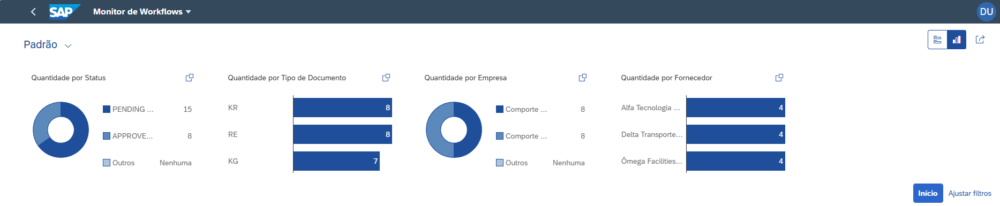
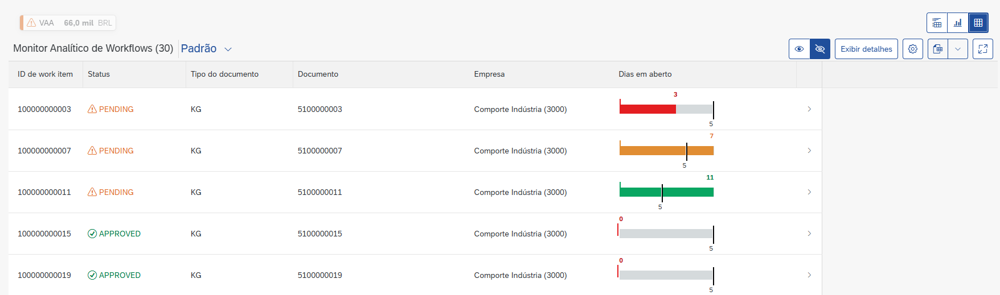
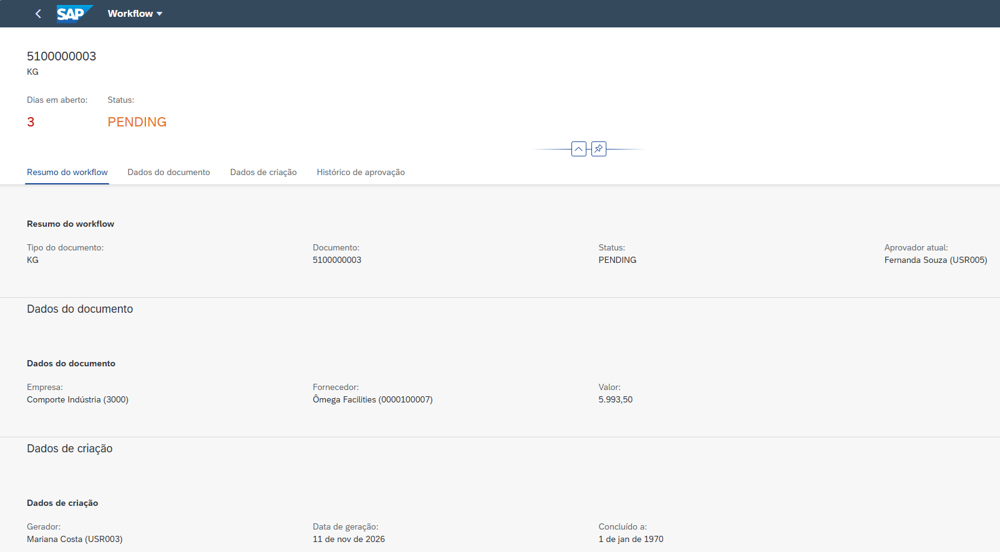
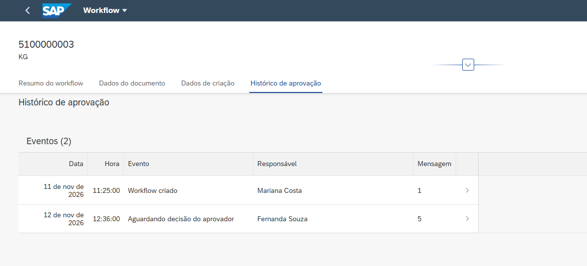

# SAP Workflow Monitor – Analytical List Page

## Overview

A SAP Fiori Elements Analytical List Page (ALP) application designed to provide centralized visibility into SAP workflow processing, approval status, pending amounts, and approval history.

The application provides analytical insights and operational monitoring through interactive charts, visual filters, KPIs, and detailed workflow information.

## Features

### Analytical Dashboard
- Workflow distribution by company.
- Workflow distribution by document type.
- Workflow distribution by status.
- Supplier-related analytics.
- Interactive visual filters.

### KPIs
- Total pending approval amount.
- Pending amounts by supplier.
- Analytical indicators based on application filters.

### Workflow Monitoring
- Workflow ID and status.
- Document type and document number.
- Company and supplier information.
- Document amount and currency.
- Days open with criticality indicators.

### Workflow Details
- Workflow identification and summary.
- Document and creation information.
- Creator and current approver.
- Approval history, including event date, time, agent, and messages.

## Technical Architecture

| Component | Technology |
|---|---|
| Frontend | SAPUI5 |
| UI Framework | SAP Fiori Elements |
| Application Type | Analytical List Page |
| Detail Page | Object Page |
| Data Service | SAP OData V2 |
| Main Entity | WorkflowMonitor |
| History Entity | WorkflowHistory |
| KPI Entity | PendingAmountKPI |
| Development Tools | VS Code, SAP Fiori Tools, UI5 Tooling |

### OData Service

`ZUI_WF_MONITOR_ALP_O2`

### Semantic Navigation

- Semantic Object: `ZWorkflowALP`
- Action: `monitor`

## Running the Application

The project supports two execution modes.

### 1. SAP Backend Mode

Connects to the configured SAP backend and retrieves actual service data.

```bash
npm install
npm start
```

Requires access to an SAP system with the OData service activated and the appropriate authorizations.

### 2. Local Mock Mode

Runs the frontend independently of an SAP backend using the SAP Fiori Tools MockServer.

```bash
npm install
npm run start-mock
```

The mock implementation uses:

- Local OData V2 metadata.
- Local annotation XML files.
- JSON mock data.
- SAP Fiori Tools MockServer middleware.

No SAP backend connection is required for the local demonstration.

### Mock Data Structure

Mock data is maintained in:

```text
webapp/localService/mainService/data/
```

The sample dataset includes fictional:

- Workflow records.
- Approval history events.
- Companies and suppliers.
- Workflow statuses.
- Document types.
- KPI and visual filter data.

All demonstration data is fictional and uses BRL as the currency.

Developers can modify or extend the JSON files to create additional demonstration scenarios.

## Requirements

- Node.js and npm.
- SAP Fiori Tools.
- UI5 Tooling.
- SAPUI5 1.96.50 or higher.
- SAP backend access for SAP-connected execution only.

## Project Structure

```text
workflow-monitor-alp/
├── webapp/
│   ├── annotations/
│   ├── localService/
│   │   └── mainService/
│   │       ├── metadata.xml
│   │       ├── ZUI_WF_MONITOR_ALP_O2_VAN.xml
│   │       └── data/
│   ├── manifest.json
│   └── Component.js
├── ui5.yaml
├── ui5-mock.yaml
├── package.json
└── README.md
```


## Application Screenshots

### Analytical Dashboard

Interactive analytical dashboard with workflow distribution by status, document type, company, and supplier.



### Workflow Monitoring

Main workflow table with status indicators, document information, and overdue days.



### Workflow Details

Detailed view of an individual workflow and its business information.



### Approval History

Workflow approval history with event dates, times, agents, and descriptions.



## Disclaimer

This project is intended for technical demonstration and portfolio purposes.

All mock data must be fictional. Backend connectivity and SAP-specific configurations may need adaptation to the target SAP environment.

The project does not include SAP backend implementation or authorization configuration.